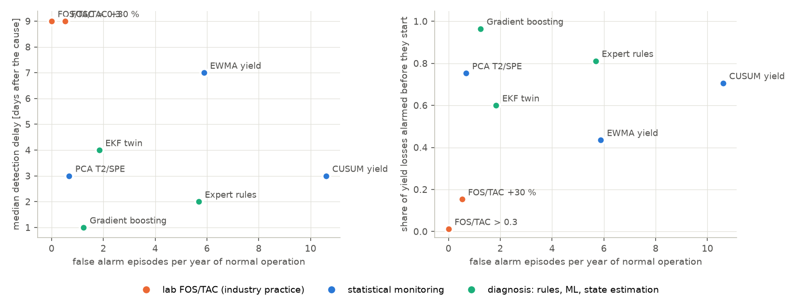
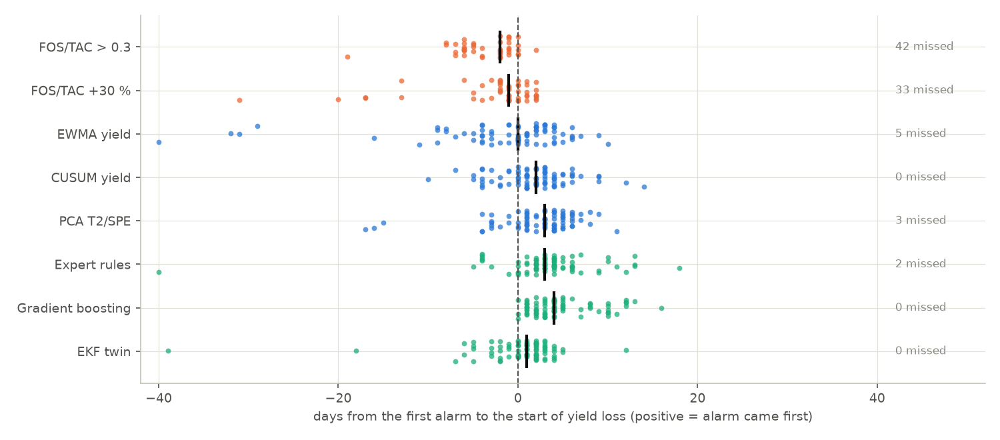
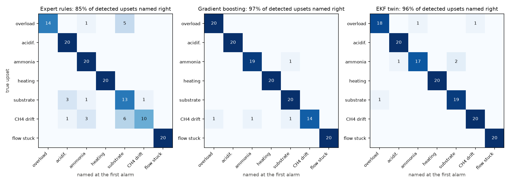
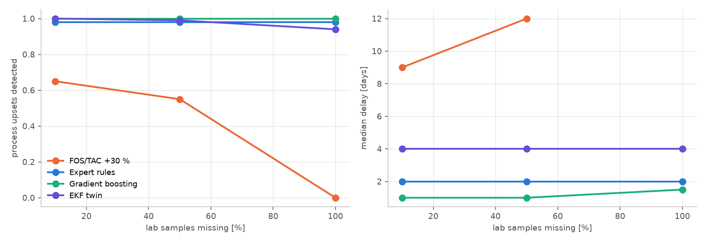
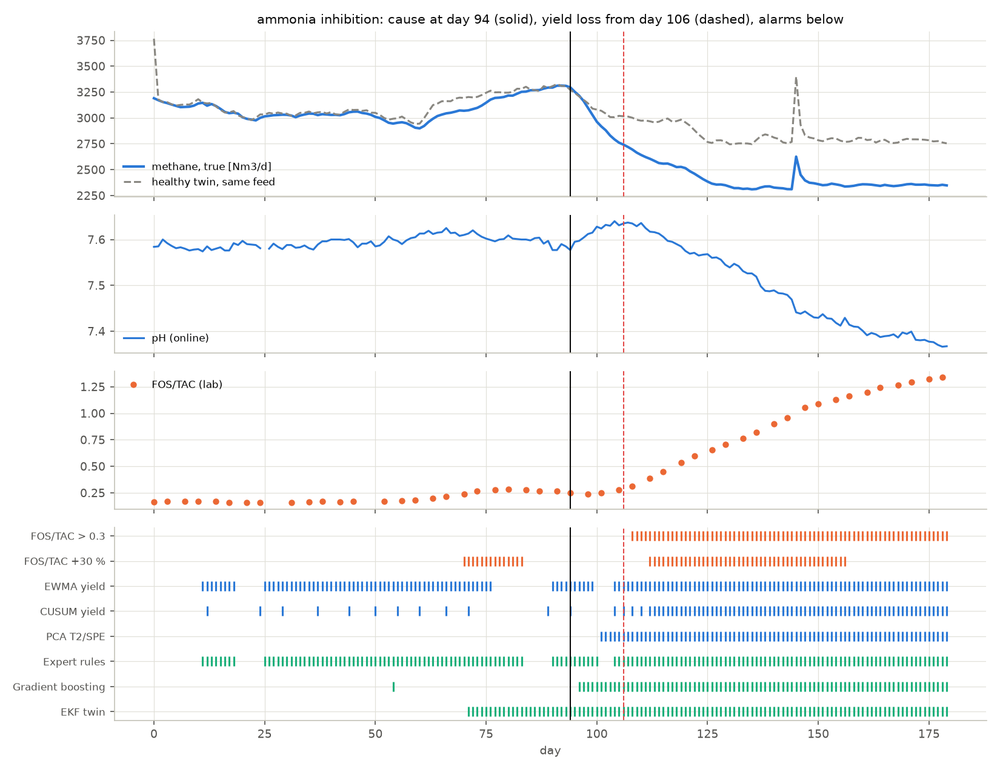
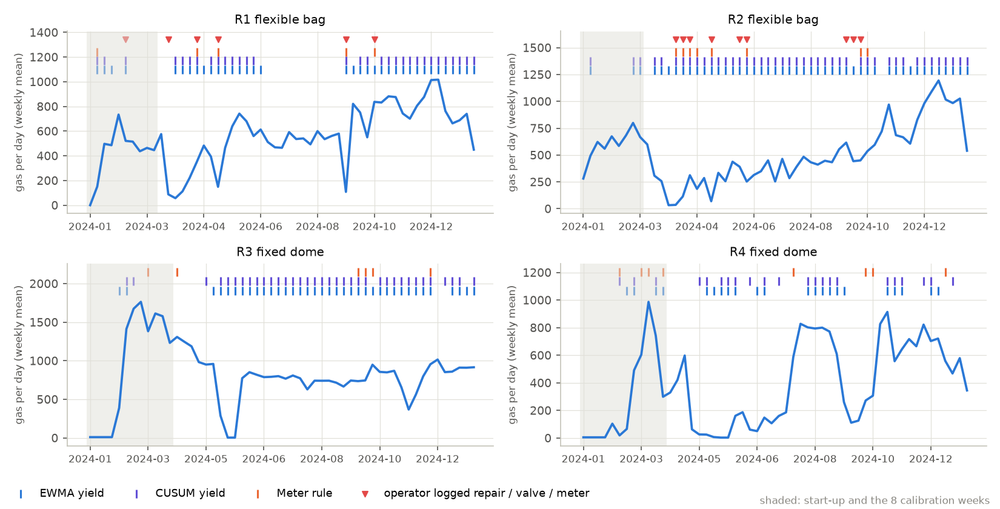

# Which method catches a sick biogas digester first?

[](https://github.com/kwwaleszczynski-del/biogas-digester-twin/actions/workflows/ci.yml)

**Interactive dashboard - replay any upset with its sensors and every method's alarms, method comparison,
confusion matrices, real farm data:
[kwwaleszczynski-del.github.io/biogas-digester-twin](https://kwwaleszczynski-del.github.io/biogas-digester-twin/)**

An agricultural biogas plant fails quietly. Volatile fatty acids build up for days or weeks before the gas
yield drops, and by the time the CHP output falls the process may need weeks to recover. The usual
safeguard is the FOS/TAC titration, done once or twice a week. This project asks **which monitoring
methods detect and classify digester upsets earliest and with the fewest false alarms, before the gas
yield drops**, and whether they can tell a process upset from a faulty instrument.

Open operating data from full-scale biogas plants with CHP are practically unavailable, and the few open
sets carry no record of what went wrong when. So the core is a **simulator with ground truth**: the IWA
Anaerobic Digestion Model No. 1 in its BSM2 implementation, verified against the published BSM2 steady state,
set up as a maize silage and cattle slurry plant of about 0.5 MWel. Seven kinds of upset are injected with
known start and known yield loss, the plant is watched through realistic sensors, and eight methods are
compared on test runs none of them saw while being tuned. Open data from four small farm-scale digesters
serve for the one thing a simulator cannot provide: false alarms and plausibility on real measurements.

It is the biogas counterpart of the outage studies in this portfolio
([PV outage classification](https://github.com/kwwaleszczynski-del/pv-outage-classifier),
[wind turbine downtime and availability](https://github.com/kwwaleszczynski-del/wind-downtime-availability));
a sibling project in preparation, `pl-biogas-flex`, looks at the same kind of plant from the power market
side.

## Key results

All numbers are measured on the test set: 140 upsets (20 per type) and three normal years that no method
saw while it was fitted or tuned (protocol in [Validation](#validation)). Of the 100 process upsets, 85 went
on to lose yield; the lead time counts days from the first alarm to the start of that loss.

**1. The lab routine is safe but late. FOS/TAC twice a week sees only the acid-forming upsets and mostly
after the gas has already dropped.**

| method (lab 10 % missing) | process upsets detected | sensor faults detected | median delay [d] | alarmed before yield loss | median lead [d] | false alarms per year | named right |
|---|---|---|---|---|---|---|---|
| FOS/TAC > 0.3 | 50 % | 0 % | 9 | 1 % | -2 | 0.0 | |
| FOS/TAC +30 % (plant-specific trend) | 65 % | 5 % | 9 | 15 % | -1 | 0.5 | |
| EWMA on specific methane yield | 92 % | 78 % | 7 | 44 % | 0 | 5.9 | |
| CUSUM on specific methane yield | **100 %** | 95 % | 3 | 71 % | 2 | 10.6 | |
| PCA T2/SPE on online signals | 97 % | 63 % | 3 | 75 % | 3 | 0.7 | |
| Expert rules | 98 % | **100 %** | 2 | 81 % | 3 | 5.7 | 85 % |
| Gradient boosting | **100 %** | 93 % | **1** | **96 %** | **4** | 1.2 | **97 %** |
| EKF twin | **100 %** | **100 %** | 4 | 60 % | 1 | 1.8 | 96 % |

- FOS/TAC raises no false alarms, but it cannot see a heating failure, a poorer silage or a broken
  instrument, and a sample every three or four days is simply too slow: for the ammonia upsets, which build
  up over weeks, the absolute threshold of 0.3 is crossed a median **18 days** after the cause and **6 days
  after** the yield loss began. The plant-specific trend rule (+30 % over the last 8 samples) is 5 days
  faster and still mostly late.
- **The best label-free detector is PCA on the online signals**: alarmed before the yield loss in 75 % of
  the cases with 0.7 false alarms a year. The CUSUM on specific yield is faster on average but pays with
  more than ten false alarms a year, because the silage dry matter the operator books drifts between clamps.
- Gradient boosting looks best on every column, and the next point shows why that is optimistic.



**2. The slow upset is where early warning pays.** Ammonia inhibition from an N-rich co-substrate builds up
for a median 12 days before the 7-day methane falls 5 % short, and costs a median 17 % of the methane over
the following three months. The online methods warn ahead of it: gradient boosting a median 10 days before
the loss, the expert rules 8, PCA 6, CUSUM and EWMA 4; FOS/TAC is 2-6 days late. Shock loads, heating
failures and poorer silage cost gas within 2-5 days, so there the useful number is the delay: a heating failure shows on
the temperature probe, and every method that reads it (PCA, rules, gradient boosting, EKF) alarms within one
or two days, 3-4 days before the yield loss; the yield charts, which do not, need 6-9 days.



**3. Gradient boosting is only as good as its training upsets.** Retrained without one upset type and
tested on that type, it still notices the large process upsets (ammonia and shock loads 100 %, heating
90 %), but names them wrongly (19 of 20 ammonia upsets called "substrate change"), and it **misses the
instrument faults it has never seen: 10 % of the CH4 analyser drifts, 30 % of the stuck flow meters**.
A real plant has no labelled history of its rare failures.

**4. The EKF twin needs no examples of failures and separates instrument from process.** It estimates the
CH4 analyser's bias alongside the process, so all 20 analyser drifts are named as such (the expert rules: 10
of 20, the others mostly called a substrate change), and 99 % of its detections are on the right side of the
process/sensor line. Its weakness is speed: its alarms wait for a clear loss of methanogenic activity or VFA
build-up, so it is alarmed before the yield loss in 60 % of the cases. It also leans on the lab: with no
FOS/TAC at all it names 83 % right instead of 96 % and raises 2.7 false alarms a year instead of 1.8.



**5. Without the lab.** Losing half or all of the FOS/TAC samples changes nothing for the online methods,
costs gradient boosting little (alarmed before loss 96 % -> 89 % with no lab at all) and the EKF twin some
naming accuracy, and leaves the lab rules blind.



**6. On real farm data the yield charts are not usable as they are.** On four small manure-fed digesters
(below) the EWMA on gas per kg manure, calibrated on each digester's own first eight weeks, is in alarm on
37-85 % of the days; the CUSUM raises 7-22 alarm episodes a year. Gas output there is dominated by how the
digester is operated. The one rule that transfers is the data-quality check: all 8 alarm episodes of the
frozen-or-backwards meter rule on the two digesters with an operator log start within three days of a note
about a repair, a closed valve or the meter.

An example: the ammonia upset of test run 100 - true methane against the healthy twin, the sensors, the
FOS/TAC samples, the EKF's VFA estimate and every method's alarms:



## The twin

### ADM1 with the BSM2 implementation details, verified

`src/biogas_twin/adm1.py` is an own implementation of ADM1 (Batstone et al. 2002) with the implementation
choices of the Benchmark Simulation Model No. 2 (Rosen & Jeppsson 2006): 26 liquid states, three gas-phase
states, Hill-type pH inhibition, the acid-base system solved algebraically (charge balance by Newton-Raphson
at every call, the "DAE" variant), the temperature-dependent constants and the gas outlet
$`q_{gas} = k_p (P_{gas} - P_{atm})`$. Integrated with constant BSM2 influent from a state far away (biomass
halved, solubles doubled), it settles on the published BSM2 steady state within a **relative deviation of
2e-7** for every state, the pH, the ions and the gas flow (a test keeps it below 1e-5):

| BSM2 steady state | published | this implementation |
|---|---|---|
| pH | 7.46554 | 7.46554 |
| acetate S_ac [kg COD/m3] | 0.197630 | 0.197630 |
| inorganic nitrogen S_IN [kmol/m3] | 0.130230 | 0.130230 |
| methane in the gas phase [kg COD/m3] | 1.625607 | 1.625607 |
| gas flow at atmospheric pressure [m3/d] | 2955.70 | 2955.70 |

Two additions are switched off in the BSM2 set and on for the agricultural plant: kinetic rates scale as
$`k(T) = k(T_{ref})\, e^{\theta (T - T_{ref})}`$, and the free-ammonia inhibition of acetoclastic
methanogens keeps ADM1's form $`I = 1/(1 + S_{NH_3}/K_I)`$ with an optional Hill exponent (left at 1).

### The plant (assumptions)

| | value | why |
|---|---|---|
| digester | one CSTR, 3000 m3 liquid, 600 m3 gas, 40 °C | main digester of a typical 0.5 MWel maize/slurry plant |
| feed | 26 t/d maize silage + 30 t/d cattle slurry, once a day | HRT 54 d, OLR 3.45 kg oDM/(m3 d) |
| hydrolysis | first order, 0.25 1/d | rate-limiting step for silage |
| uptake of propionate, acetate | 1.2 and 4.5 1/d (BSM2: 13 and 8) | BSM2 kinetics are for sewage sludge; lowered so that the steady-state acids (about 0.7 g/L acetic, 0.12 g/L propionic acid) and the room before overload match agricultural plants |
| temperature factor θ | 0.035 1/K hydrolysis, acidogenesis, decay; 0.069 1/K acetogenesis, methanogenesis | methanogenic rates halve per 10 K below the set point |
| ammonia inhibition | ADM1 default, $`K_I`$ = 0.0018 kmol N/m3 | gives the "inhibited steady state" with little spare methanogenic capacity that ammonia-rich agricultural plants run at |

The resulting plant: pH 7.6, 53.5 % CH4, 6,000 Nm3 biogas per day (3,220 Nm3 CH4, about 540 kWel at 40 %
electrical efficiency), 0.31 Nm3 CH4 per kg oDM fed, TAN 2.4 g/L, FOS 1,840 mg/L, TAC 11,000 mg CaCO3/L,
FOS/TAC 0.17.

### Substrates (assumptions, typical values)

Weender-type composition per kg dry matter, chosen inside the ranges given in the FNR *Leitfaden Biogas*
and the KTBL standard yields; mapped to ADM1 inputs directly as carbohydrates, proteins, lipids, sugars and
acids (common practice for agricultural ADM1 applications, e.g. Lübken et al. 2007, Koch et al. 2010), with
a substrate-specific anaerobic degradability splitting off the inert part.

| per kg DM | maize silage | cattle slurry | poultry manure (N-rich, ammonia scenario) | sugar beet (shock load) |
|---|---|---|---|---|
| dry matter [% FM] | 33 | 9 | 45 | 23 |
| organic DM [% DM] | 95.5 | 80 | 72 | 92 |
| crude protein | 0.085 | 0.15 | 0.26 | 0.05 |
| crude fat | 0.032 | 0.035 | 0.025 | 0.005 |
| free sugars | 0.010 | - | - | 0.68 |
| silage acids / VFA | 0.065 | 0.045 | 0.02 | - |
| anaerobic degradability | 0.90 | 0.50 | 0.65 | 0.95 |
| ammonium N [kg/t FM] | 0.4 | 2.6 | 6.0 | 0.1 |

COD factors: carbohydrate 1.185, protein 1.50, lipid 2.90, organic acids 1.067, sucrose 1.123 kg COD/kg.
Fed alone to the plant's digester (HRT 54 days), the maize silage gives 0.36 Nm3 CH4 per kg oDM (KTBL:
0.355 for maize silage with good silage management) and the cattle slurry 0.20; a test keeps the mix
between the two.

### What the operator sees

| signal | how | imperfections |
|---|---|---|
| biogas flow | hourly, Nm3/h dry | 2 % noise, a fixed calibration error of ±2 %, 1 % dropouts, outages of 2-36 h (about 2 per quarter) |
| CH4 content | hourly | 0.3 %-point noise, slow drift re-zeroed by a monthly calibration |
| pH | hourly, in the digester | 0.02 noise, electrode drift recalibrated monthly |
| temperature | hourly | 0.1 K noise |
| FOS/TAC | lab, Monday and Thursday | titration volumes ±0.1 mL (A) and ±0.05 mL (B); 10 % of samples missing |
| ammonium N | lab, Monday | ±5 % |
| feed log | daily, t per substrate | ±2 % weighing; oDM booked with the nominal silage dry matter (true DM drifts between clamps, 31-35 %) |

FOS/TAC is not a random number added to the VFA: the Nordmann titration is simulated on the ADM1 acid-base
state of the sample (20 mL titrated with 0.1 N H2SO4 to pH 5.0, volume A, and on to pH 4.4, volume B):

```math
\mathrm{TAC} = 250\,A \ [\mathrm{mg\ CaCO_3/L}], \qquad
\mathrm{FOS} = (1.66\,B - 0.15)\cdot 500 \ [\mathrm{mg\ HAc/L}]
```

so FOS carries its real interference from bicarbonate and ammonia, and TAC moves with the ammonium.

### Upsets and ground truth

| upset | injected | severity drawn per run |
|---|---|---|
| organic overload | more maize silage, ramped in over 1-7 days, kept | x1.4 to x2.0 |
| acidification (shock load) | sugar beet on top of the recipe for 2-4 days | 40-90 t/d |
| ammonia inhibition | poultry manure replaces part of the silage (same oDM), ramped over 1-14 days | 40-90 % of the silage oDM |
| heating failure | temperature falls for 5-14 days, then recovers at 0.5 K/d | 0.5-1.0 K/d |
| substrate change | a new silage of lower degradability, kept | x0.65 to x0.88 |
| CH4 analyser drift | linear drift, until the end | ±0.08 to ±0.3 %-points per day |
| stuck gas flow meter | the hourly reading freezes | 7-44 days |

The ground truth of each run is its class, the start $`t_0`$ and the **start of yield loss**: the first day on
which the true methane production, averaged over the trailing 7 days, falls more than 5 % below what a
**healthy twin** produces from the same feed. The healthy twin is the same ADM1 plant without the upset
mechanism - no inhibition terms, the normal temperature, the nominal silage quality - so it is the methane
potential of what was actually fed. With $`r(t) = Q_{CH_4}(t) / Q_{CH_4}^{healthy}(t)`$ normalised by its mean
over the 14 days before $`t_0`$:

```math
t_{loss} = \min \Big\{ t \ge t_0 : \tfrac{1}{7} \sum_{s=t-6}^{t} r(s) < 0.95 \Big\}
```

Sensor faults never cause yield loss; the methods must notice them without calling them a process upset.

**Harmless recipe changes are part of normal operation.** Every 6-17 weeks the operator changes the
recipe without harm: 5-15 % of the silage oDM as poultry manure for 1-4 weeks, 5-15 t/d of sugar beet for
1-2 days, or 8-20 % more silage for 2-6 weeks (in the five normal years these cost at most 2 % of methane
over a week, VFA stay below 1.7 g COD/L). Without them every poultry manure entry in the feed log would mean
"ammonia upset coming", and a method could name the upset from the feed log before the process shows
anything - which is how a first version of this study looked, and why the changes were added (the
whole study was then re-run; no method or threshold was changed between the two runs).

## Methods

| method | uses | alarm | names the cause |
|---|---|---|---|
| **FOS/TAC > 0.3** | lab | latest result above 0.3 (a common practice threshold) | no |
| **FOS/TAC +30 %** | lab | latest result 30 % above the median of the 8 before (plant-specific trend) | no |
| **EWMA yield** | gas, CH4, feed log | EWMA of the standardised 7-day specific methane yield outside ±L sigma | no |
| **CUSUM yield** | gas, CH4, feed log | two-sided tabular CUSUM of the same | no |
| **PCA T2/SPE** | gas, CH4, pH, temperature, feed log | Hotelling T2 or SPE above the 99.5 % training quantile on 2 days | no |
| **Expert rules** | everything | the morning checks of an operator, top to bottom | yes |
| **Gradient boosting** | everything | P(normal) < 0.5 on 2 days | yes |
| **EKF twin** | everything | estimated VFA, methanogenic activity, substrate quality, analyser bias | yes |

**Specific methane yield** (Nm3 CH4 per kg oDM fed) from the measured gas, CH4 content and the feed log:
$`\mathrm{SMY}_t = \sum_{s=t-6}^{t} Q_s\, c_s \,/\, \sum_{s=t-6}^{t} m^{oDM}_s`$. Standardised with the mean and
standard deviation of two normal training years, $`z_t`$; the EWMA $`e_t = \lambda z_t + (1-\lambda) e_{t-1}`$
($`\lambda = 0.2`$) alarms outside $`\pm L \sqrt{\lambda / (2-\lambda)}`$ with $`L = 3`$; the CUSUM sums
$`C^{\pm}_t = \max(0, C^{\pm}_{t-1} \pm z_t - k)`$ with $`k = 0.5`$ and alarms above $`h = 5`$.

**PCA** on eight standardised daily variables (specific yield, gas per oDM, CH4, pH, temperature and the
7-day changes of CH4, pH and yield), components up to 90 % of the variance, fitted on the normal training
years (MacGregor & Kourti 1995):

```math
T^2 = \sum_{i=1}^{k} \frac{t_i^2}{\lambda_i}, \qquad \mathrm{SPE} = \lVert z - P P^{\top} z \rVert^2
```

**Expert rules**, checked top to bottom: frozen hourly flow (zero spread over a day) -> stuck meter;
temperature 1.5 K below the set point -> heating; otherwise an upset is flagged by the EWMA, the relative
FOS/TAC rule or a pH drop of 0.08, and named from the feed log (sugar beet -> shock load, poultry manure or
TAN above 3.2 g/L -> ammonia, oDM 20 % above the last month -> overload), else a CH4 jump of 2 %-points with
steady pH and FOS/TAC -> analyser drift, else a yield drop without VFA signs -> substrate.

**Gradient boosting** (`HistGradientBoostingClassifier`, balanced classes) on 60 daily features: levels,
3/7/14-day changes, 7-day spread and deviation from the last month of the yield, gas, CH4, pH and temperature;
the spread of the hourly flow; the latest FOS, TAC, FOS/TAC, TAN, their age and trend; the feed composition
of the last 7 and 28 days. Trained on 2 normal years and 8 runs of every upset type.

**EKF twin**: an extended Kalman filter on a reduced model of AM2 type (Bernard et al. 2001) with a hydrolysis
step, whose parameters come from lumping the ADM1 plant at its nominal steady state (no fitting to any upset):

```math
\begin{aligned}
\dot X_T &= D(s\,X_{T,in} - X_T) - k_h f_h(T) X_T + r_{dec} X_2 \\
\dot S_2 &= D(S_{2,in} - S_2) + (1-f_{H_2})(1-Y_1)\big(k_h f_h(T) X_T + D S_{1,in}\big) - r_2 \\
\dot X_2 &= Y_2\, r_2 - (D + k_d) X_2, \qquad r_2 = e^{m}\, k_2 f_m(T) \frac{S_2}{K_2 + S_2} X_2\, I_{pH} \\
\dot C &= D(C_{in} - C) + c_1 r_{ac} + c_2 r_2 - q_{CO_2}/V, \qquad \dot Z = D(Z_{in} - Z) + n_N k_h f_h(T) X_T
\end{aligned}
```

with $`X_T`$ particulate degradable COD, $`S_2`$ VFA, $`X_2`$ methanogens, $`C`$ inorganic carbon and $`Z`$
alkalinity; pH from the charge balance, CO2 to the gas by transfer, CH4 from the H2 and acetate routes. The
filter also estimates three slowly varying unknowns: $`m`$, the log activity of methanogenesis (inhibition by
ammonia, pH or overload pushes it down), $`s`$, the degradability of the feed relative to the recipe, and
$`b`$ with its drift rate, the bias of the CH4 analyser. Measurements: daily biogas, CH4 and pH; FOS and TAC on
lab days through the same titration model. Alarms: VFA estimate above 1.6 times nominal or $`m < -0.3`$;
$`m < -0.15`$ without VFA or $`s < 0.93`$ (substrate); $`|b| > 1.5`$ %-points (analyser); frozen flow; low
temperature. The cause of a VFA alarm is named from the feed log as in the rules.

## Validation

- **Training**: 2 normal years (seeds 1001-1002) and 8 runs of every upset type (seeds 0-7): EWMA, CUSUM
  and PCA in-control statistics and the gradient boosting model. The rule and EKF thresholds are set by
  hand; the code was debugged on a smoke run that included one test run per type (seed 100), and all
  thresholds were fixed before the full test set was evaluated.
- **Test**: 3 normal years (seeds 2001-2003) and 20 runs of every upset type (seeds 100-119), 140 upsets.
  Every run starts from the steady state, runs 90-96 days of normal operation (with its own feed and silage
  variation and sensor noise) and 90 days after the upset.
- **Detection**: the first alarm that starts within 60 days after $`t_0`$ (an alarm already running at
  $`t_0`$ does not count; for the classifiers a new diagnosis counts). **Lead time** $`t_{loss} - t_{alarm}`$
  for the process upsets that went on to lose yield. **False alarms**: alarm episodes (alarm days less than a
  week apart form one episode) after a 35-day warm-up in the normal years and before $`t_0`$ in every test
  run, per year of normal operation.
- **Classification**: the class named in the first three days of the first alarm, against the truth.
- **Missing lab**: every test run observed again with the same online data and 50 % and 100 % of the lab
  samples removed.
- **Unseen upset**: gradient boosting retrained seven times, each time without one upset type, tested on
  that type.

## Real farm data

The Mendeley set (D. Mulat, ILRI, 2025) holds a year of daily records from four small farm-scale
digesters fed with 20 kg of cattle manure and 30 kg of water a day (two flexible bags, two fixed domes):
the gas meter reading, feed, air and digester temperature (flexible bags only) and operator comments. The
pH, VFA, TAN and FOS/TAC columns are empty and CH4 was measured once, so only the gas-based detectors and
the data-quality rule apply. They are calibrated on each digester's first eight weeks after start-up, as
one would commission them on a new plant.

| digester | EWMA: episodes / year (days in alarm) | CUSUM: episodes / year | meter rule: episodes (near an operator note) |
|---|---|---|---|
| R1 flexible bag | 4.7 (58 %) | 8.2 | 4 (4) |
| R2 flexible bag | 4.6 (84 %) | 6.9 | 4 (4) |
| R3 fixed dome | 2.6 (81 %) | 18.0 | 3 (no log) |
| R4 fixed dome | 6.4 (37 %) | 21.8 | 3 (no log) |

Plausibility: the twin assumes methanogenic rates fall by half per 10 K. In these unheated digesters, at
18-27 °C, the weekly gas per kg manure does not rise with temperature: the fitted sensitivity is
-0.10 1/K (95 % interval -0.17 to -0.03) for R1 and -0.05 (-0.11 to 0.01) for R2, with weeks near operator
notes left out. Operation (gas use, valve handling, start-up after repairs) swamps the temperature effect,
so the data can neither confirm nor refute the assumption.



## Limitations

- **The plant is a model.** ADM1 with plausible agricultural parameters is a well-established description,
  but the kinetics, the inhibition constants and the substrate characterisation are assumptions, not a
  calibration to one real plant. The ranking of methods should transfer; the exact days and rates will not.
- **One digester, one recipe.** Real plants have a main and a secondary digester, mixing problems, foaming,
  floating layers, trace-element deficiencies, sulphide and desulphurisation - none of which is simulated.
- **The upsets are the textbook ones**, each alone; real incidents overlap (a new silage clamp in winter
  with a cold snap).
- **The feed log helps a lot.** Rules, gradient boosting and the EKF name overload, shock load and ammonia
  partly from what was fed. That is realistic - the operator knows the feed - but it means the
  classification of those upsets is easier than detecting them.
- **Gradient boosting has seen every upset type in training**, with severities from the same ranges; its
  numbers are an optimistic bound. The unseen-type experiment shows what remains without that help.
- **The real data cannot validate detection.** The open farm-scale set has no pH, VFA or FOS/TAC and no
  documented process upsets; it checks false alarms and plausibility only.
- **Lab error is idealised** as noise on the titration volumes; real FOS/TAC also depends on sample
  handling, degassing and the analyst.

## Possible version 2 (not built)

Demand-driven feeding for a flexible CHP: when a plant shifts its gas production to the high-price hours
(the subject of the sibling project `pl-biogas-flex`, in preparation), the feed varies
day to day by design. Every yield-based detector here assumes a steady recipe; with flexible feeding the
expected gas must come from a model of the feed response, which is exactly what the EKF twin provides. A
v2 would replay the flexible feeding schedules from that project through this twin and check which methods
keep their false-alarm rate.

## Run it

```bash
pip install -e ".[dev]"
pytest -q                                    # 13 tests, offline, about 30 s
python -m biogas_twin verify                 # ADM1 against the BSM2 steady state
python -m biogas_twin fetch                  # the Mendeley farm data, 12 MB, CC BY 4.0, checksum verified
python -m biogas_twin study --workers 6      # 201 simulations + 429 evaluations, about an hour
python -m biogas_twin real                   # false alarms on the farm data
python -m biogas_twin report                 # results/, docs/img, docs/data.js
```

```
src/biogas_twin/
  adm1.py        ADM1 with the BSM2 implementation details; the BSM2 reference case
  substrates.py  substrate composition -> ADM1 influent
  plant.py       the agricultural plant, daily feeding, hourly outputs
  scenarios.py   upsets, the healthy twin, the yield-loss ground truth
  sensors.py     online sensors, the FOS/TAC titration model, lab, feed log, the daily table
  methods.py     FOS/TAC rules, EWMA/CUSUM, PCA, expert rules, gradient boosting
  am2.py         the reduced model, its calibration from ADM1, the EKF and its alarms
  evaluate.py    detection, lead time, false alarms, confusion
  study.py       the campaign; realdata.py the farm-data check; report.py figures and dashboard data
tests/           13 tests: BSM2 verification, plant plausibility, titration, scenarios, methods, scores
```

## Data, sources and licence

Code: MIT. The simulator needs no data. Farm data, downloaded on demand and not part of this repository
(`results/` and the dashboard hold derived figures only: alarm counts, weekly means):

- D. Mulat (ILRI), *Process monitoring and weather datasets on farm-scale biogas digesters*, Mendeley Data
  V1, 2025, [doi:10.17632/gk3f363sfg.1](https://doi.org/10.17632/gk3f363sfg.1), CC BY 4.0. Changes: dates
  repaired where the spreadsheet swapped day and month, the cumulative gas meter differenced per day,
  impossible readings and temperatures (0 °C, 55 °C) set to missing, weekly means for display.

References:

- Batstone D.J. et al. (2002). *Anaerobic Digestion Model No. 1 (ADM1)*. IWA Scientific and Technical
  Report No. 13. IWA Publishing.
- Rosen C., Jeppsson U. (2006). *Aspects on ADM1 implementation within the BSM2 framework*. Department of
  Industrial Electrical Engineering and Automation, Lund University.
- Rosen C., Vrecko D., Gernaey K.V., Pons M.N., Jeppsson U. (2006). Implementing ADM1 for plant-wide
  benchmark simulations in Matlab/Simulink. *Water Science and Technology* 54(4), 11-19.
- Bernard O., Hadj-Sadok Z., Dochain D., Genovesi A., Steyer J.-P. (2001). Dynamical model development and
  parameter identification for an anaerobic wastewater treatment process. *Biotechnology and
  Bioengineering* 75(4), 424-438.
- Lübken M., Wichern M., Schlattmann M., Gronauer A., Horn H. (2007). Modelling the energy balance of an
  anaerobic digester fed with cattle manure and renewable energy crops. *Water Research* 41, 4085-4096.
- Koch K., Lübken M., Gehring T., Wichern M., Horn H. (2010). Biogas from grass silage - measurements and
  modeling with ADM1. *Bioresource Technology* 101, 8158-8165.
- Chen Y., Cheng J.J., Creamer K.S. (2008). Inhibition of anaerobic digestion process: a review.
  *Bioresource Technology* 99, 4044-4064.
- Nordmann W. (1977). Die Überwachung der Schlammfaulung. *KA-Informationen für das Betriebspersonal*,
  Beilage zur Korrespondenz Abwasser 3/77.
- MacGregor J.F., Kourti T. (1995). Statistical process control of multivariate processes. *Control
  Engineering Practice* 3(3), 403-414.
- FNR (2016). *Leitfaden Biogas - Von der Gewinnung zur Nutzung*. Fachagentur Nachwachsende Rohstoffe.
- KTBL (2013). *Faustzahlen Biogas*, 3rd ed. Kuratorium für Technik und Bauwesen in der Landwirtschaft.

The published BSM2 steady-state values used in the verification test are the ones tabulated by Rosen &
Jeppsson (2006), as also used in the test suites of open ADM1 implementations (QSDsan/EXPOsan, PyADM1).
